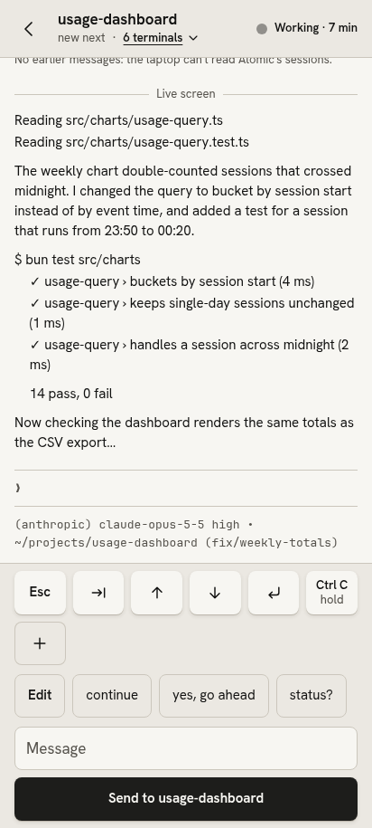

# hermux

A phone web app for supervising coding agents that run in [Herdr](https://herdr.dev) panes, reached privately over [Tailscale](https://tailscale.com). See which agents need you, read what they did, answer their questions and send them new instructions from a normal text box, without a terminal app on your phone.

It installs to the home screen and shows up there as "Agents".

<p>
  
  
  
</p>

The screenshots use the built-in sample data (`?demo`).

## Features

- **Inbox:** the agents that are blocked on a question or approval, and the ones that finished since you last opened them.
- **Activity:** working agents and the most recently active others, newest first; older sessions are one tap away.
- **The Reader:** an agent's screen as readable text, with its earlier messages loaded above as you scroll up.
- **Keys:** Esc, Tab, arrows, Enter and a hold-to-send Ctrl+C, plus number keys while an agent is asking. Add your own keys to the bar.
- **Saved commands:** one-tap replies you set up yourself.
- **The switcher:** every terminal in a Herdr workspace, agents and plain shells, one tap apart.
- **Live updates:** status changes arrive at once through Herdr's events, with polling as a fallback.
- **Light and dark:** follows the phone, or pick one. Built to stay legible in sunlight.

## Requirements

- [Bun](https://bun.sh) 1.x
- [Herdr](https://herdr.dev) (tested with 0.9.5), running the agents
- [Tailscale](https://tailscale.com) on the computer and on the phone

## Quick start

```bash
git clone <this repository> hermux
cd hermux
bun install
echo 'AGENTS_ALLOWED_LOGIN=<you@example.com>' > .env.local
scripts/start.sh
```

Run `scripts/start.sh` inside a Herdr pane: the server refuses to start anywhere else. It listens on `127.0.0.1:8787` only. Then publish it to your tailnet once, with HTTPS and without Funnel:

```bash
tailscale serve --bg --https=443 http://127.0.0.1:8787
```

Open `https://<your-machine>.<your-tailnet>.ts.net` on your phone and add it to the home screen. The full guide is [docs/setup.md](docs/setup.md).

To look around without Herdr's agents, open the app with `?demo` for the sample data.

## Security model

- **Tailnet only.** The server binds to `127.0.0.1` and is reached through `tailscale serve`, so only devices on your tailnet can get to it. Never use `tailscale funnel` with it: that would put it on the public internet.
- **Login check.** Every request must carry the `Tailscale-User-Login` header that `tailscale serve` adds, and it must equal `AGENTS_ALLOWED_LOGIN`. Anything else gets `403`. The setting is required: without it the server doesn't start, and there is no fallback that lets anyone in.
- **Same-page requests only.** Sends must be JSON from the app's own page; cross-site requests are refused.
- **Narrow reach into Herdr.** The server runs a fixed set of Herdr commands, sends only allow-listed keys, and re-checks a pane just before each send. Its subscription to Herdr's events is read-only.

## Development

```bash
bun test            # the test suite
bun run typecheck   # strict type check of the server, the page and the tests
```

There is no build step: the page is plain HTML, CSS and JavaScript served as is. `DESIGN.md` describes the design system and `GLOSSARY.md` the words the app uses.

## Licence

[MIT](LICENSE)
