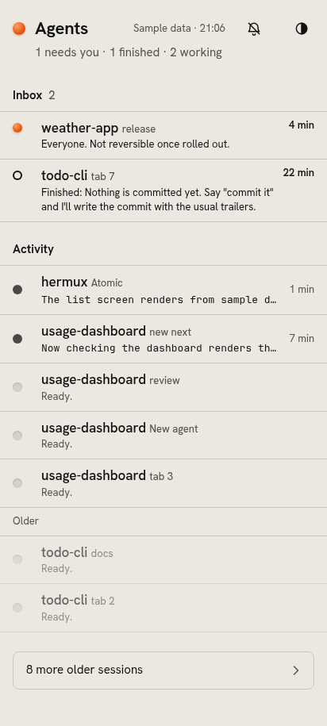
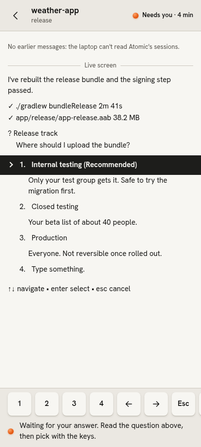
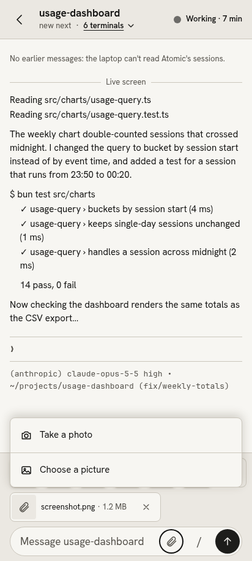
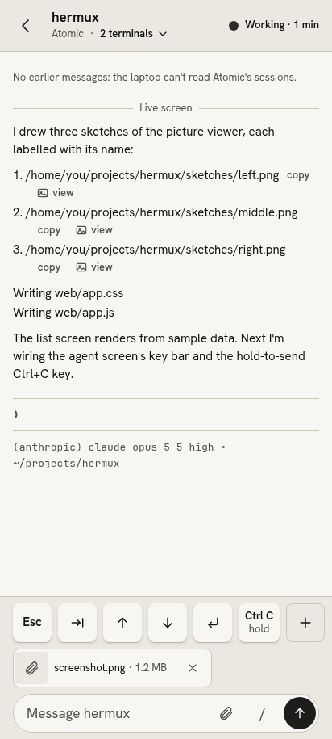
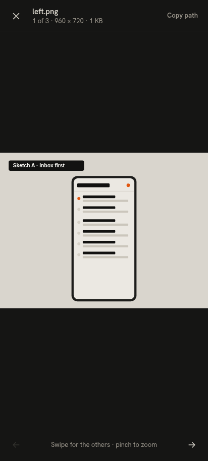
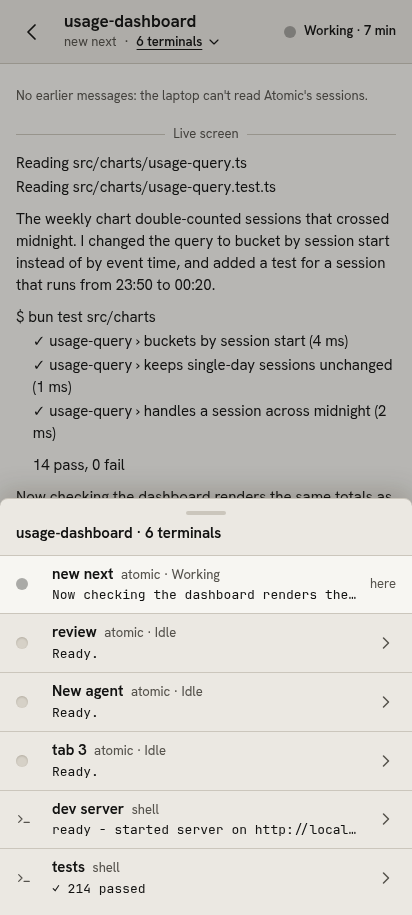

# hermux

hermux is a phone web app for watching and steering coding agents that run in [Herdr](https://herdr.dev) panes. You reach it privately over [Tailscale](https://tailscale.com). It shows which agents need you and what they did, and lets you answer them or send new instructions from a normal text box. You don't need a terminal app on your phone.

It installs to your home screen as "Agents".

| | | |
|:---:|:---:|:---:|
|  |  |  |
| **Home**: who needs you, what finished, what's working | **Answer questions** with big keys | **Send pictures**: camera or gallery |
|  |  |  |
| **Reader**: picture paths get a view key | **Open computer pictures** full screen | **Switcher**: every terminal in the workspace |

The screenshots use the built-in sample data (`?demo`).

## Features

- **Inbox.** Agents waiting on a question or approval, and agents that finished since you last opened them.
- **Activity.** Working agents first, then the most recently active others. Older sessions are one tap away.
- **Reader.** An agent's screen as readable text. Scroll up to load its earlier messages. Links open in a new tab.
- **Keys.** Esc, Tab, arrows and Enter, number keys while an agent is asking, and a Ctrl+C you hold to send. You can add your own keys.
- **Saved commands.** One-tap replies you write yourself, behind the "/" button in the message bar.
- **Send pictures.** Attach a screenshot, a photo from your gallery, or a new one from the camera. The picture is saved on the computer and its path goes into your message, so the agent can open it.
- **Open computer pictures.** A picture path in an agent's output gets a view key. It opens full screen, with zoom and swipe between pictures. Only pictures in your home folder or `/tmp`, outside hidden folders, can be opened.
- **Notifications.** Optional push notifications when an agent needs you or finishes, turned on from the bell.
- **Switcher.** Every terminal in a Herdr workspace, agents and plain shells, one tap apart.
- **Live updates.** Status changes and new output stream from Herdr as they happen. If the stream drops, the app polls until it's back.
- **Instant open.** The app's files are cached on the phone, so it opens before the network answers.
- **Light and dark.** Follows the phone, or pick one. Readable in sunlight.

## Requirements

- [Bun](https://bun.sh) 1.x
- [Herdr](https://herdr.dev), tested with 0.9.5, running your agents
- [Tailscale](https://tailscale.com) on the computer and the phone

## Quick start

```bash
git clone <this repository> hermux
cd hermux
bun install
echo 'AGENTS_ALLOWED_LOGIN=<you@example.com>' > .env.local
scripts/start.sh
```

Run `scripts/start.sh` inside a Herdr pane. The server won't start anywhere else, and it listens only on `127.0.0.1:8787`. Then publish it to your tailnet once, with HTTPS and without Funnel:

```bash
tailscale serve --bg --https=443 http://127.0.0.1:8787
```

Open `https://<your-machine>.<your-tailnet>.ts.net` on your phone and add it to the home screen. [docs/setup.md](docs/setup.md) has the full guide.

To try the app without real agents, open it with `?demo`.

## Security model

- **Tailnet only.** The server binds to `127.0.0.1`, and `tailscale serve` is the only way in, so only devices on your tailnet reach it. Don't use `tailscale funnel` with it. Funnel would put it on the public internet.
- **Login check.** Every request must carry the `Tailscale-User-Login` header that `tailscale serve` adds, and it must match `AGENTS_ALLOWED_LOGIN`. Anything else gets `403`. The server refuses to start without this setting, and nothing lets a request in without it.
- **Same-page requests only.** The app's own page must send JSON. The server refuses cross-site requests.
- **Narrow reach into Herdr.** The server runs a fixed set of Herdr commands, sends only allowed keys, and checks the pane again just before each send. It only reads Herdr's events and terminal streams.

## Development

```bash
bun test            # the test suite
bun run typecheck   # strict type check of the server, the page and the tests
```

There's no build step. The page is plain HTML, CSS and JavaScript, served as is. `DESIGN.md` describes the design system, and `GLOSSARY.md` the words the app uses.

## Licence

[MIT](LICENSE)
